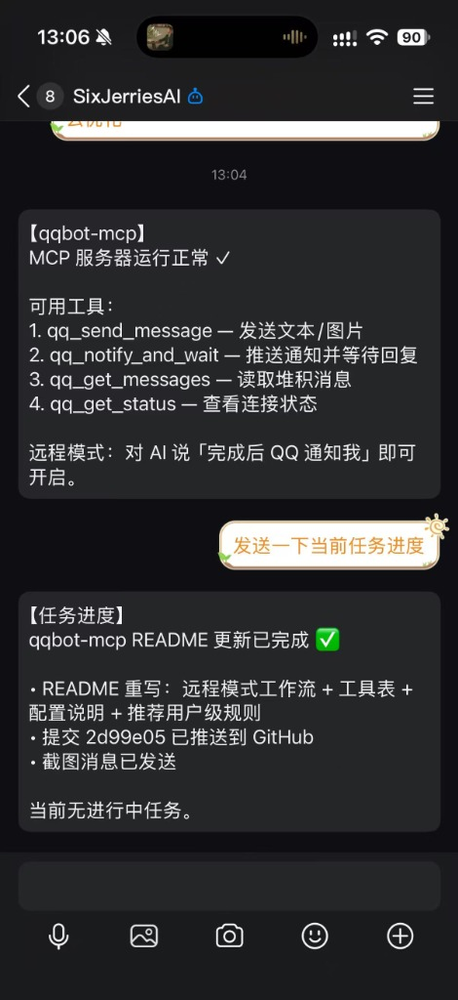

# qqbot-mcp

QQ 机器人 MCP 服务器 —— 让 AI 编程助手（Devin / Windsurf 等）通过 QQ 与你保持联系。

替代旧的 `cascade-qqbot-bridge` 浏览器注入插件：AI 直接通过 MCP 工具主动推送消息到 QQ，并**阻塞等待你的远程指令**，不再依赖 DOM 注入。

## 核心场景：远程模式

人离开电脑时，让 AI 继续干活并随时接管：

```
干活 → QQ 汇报结果 → 阻塞等待你的 QQ 回复 → 按指令继续干活 → …
```



1. 在 IDE 里告诉 AI「完成后 QQ 通知我」「我去吃饭了」等
2. AI 完成任务后通过 `qq_notify_and_wait` 推送标题+摘要+候选操作到 QQ
3. 你在 QQ 回复数字选项或任意指令，AI 立即继续执行

人坐在电脑前时不需要 QQ 通知——直接在 IDE 对话即可（建议配合用户级规则限定仅在远程模式下推送，避免打扰）。

## 工具

| 工具 | 说明 |
|------|------|
| `qq_send_message` | 发送文本和/或本地图片（`image_paths` 绝对路径数组） |
| `qq_notify_and_wait` | 推送「标题+摘要+可选选项+可选图片」，阻塞等待 QQ 回复并返回指令文本（默认 300s，最长 7200s） |
| `qq_get_messages` | 读取无等待期间堆积的入站消息（客户端 abort 阻塞请求时回复会进此队列，不丢失） |
| `qq_get_status` | 网关连接状态 / 最近会话目标 / 沙箱模式 |

## 配置

在 `mcp_config.json` 注册：

```json
"qqbot": {
  "command": "node",
  "args": ["/path/to/qqbot-mcp/server.js"],
  "env": {
    "QQBOT_APP_ID": "你的 AppID",
    "QQBOT_APP_SECRET": "你的 AppSecret",
    "QQBOT_SANDBOX": "1",
    "QQBOT_DEFAULT_USER": "兜底私聊 user_openid（可选）",
    "QQBOT_DEFAULT_GROUP": "兜底群 group_openid（可选）"
  }
}
```

| 环境变量 | 说明 |
|---------|------|
| `QQBOT_APP_ID` / `QQBOT_APP_SECRET` | QQ 开放平台机器人凭证（**必填**） |
| `QQBOT_SANDBOX` | `1`=沙箱环境（默认），`0`=正式 |
| `QQBOT_DEFAULT_USER` / `QQBOT_DEFAULT_GROUP` | 兜底发送目标（可选）。未配置时需用户先给机器人发条消息建立会话；之后自动记住最近会话目标并持久化到 `~/.qqbot-mcp-target.json` |

依赖：`npm install`（`@modelcontextprotocol/sdk`、`ws`、`zod`），Node.js ≥ 18。

## 推荐的用户级 AI 规则

将以下内容加入 AI 助手的用户级规则（如 Devin 的 `~/.config/devin/AGENTS.md`），实现按意图触发的远程模式：

```markdown
# QQ 机器人通知规则

配置了 `qqbot` MCP 时，QQ 通知默认关闭，仅在「远程模式」下使用：

1. 默认行为：用户正在对话 = 人在电脑前，直接在聊天中回复，不发 QQ。
2. 进入远程模式：用户表示离开电脑（"完成后 QQ 通知我"等）→ 任务完成必须调用
   `qq_notify_and_wait` 推送结果并阻塞等待 QQ 指令。
3. 退出远程模式：用户回来说话或 QQ 回复要求停止 → 恢复默认行为。
4. 等待超时不是失败：可再次调用继续等待，或用 `qq_get_messages` 检查堆积消息。
```

## 实现要点

- **传输**：stdio JSON-RPC，stdout 仅走协议、日志全走 stderr
- **收消息**：QQ 网关 WebSocket，订阅 `C2C_MESSAGE_CREATE` + `GROUP_AT_MESSAGE_CREATE`，断线自动重连 + 心跳
- **发消息**：被动回复（`msg_id`，5 分钟时限内）优先，超时自动降级主动发送（`msg_seq`）；超 500 字自动分段
- **等待机制**：单 waiter 阻塞模型；无 waiter 时入站消息进 `inbox` 队列，`qq_get_messages` 消费
- **发图片**：先 `file_type=1` 上传拿 `file_info`，再 `msg_type=7` 富媒体消息

## 注意

- 沙箱环境需要用户/群已加入沙箱白名单；主动消息有月度额度限制，被动回复无限制
- 同一机器人凭证同时只能有一个 gateway 会话正常收消息——请确保旧的 `cascade-qqbot-bridge` 插件已禁用（`cascadeQQBot.enabled: false`）
- MCP 客户端若对长阻塞请求有超时限制，回复不会丢——进 inbox 由 `qq_get_messages` 兜底
